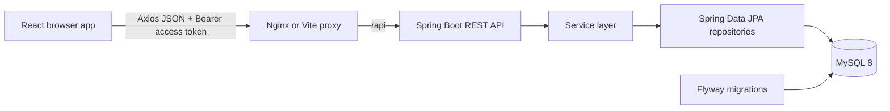

# System architecture

The frontend uses React Router and Context providers for authentication, notifications, and theme preferences. API calls are centralized through Axios; the production Nginx config proxies `/api` to the backend, while Vite proxies `/api` to localhost during development.

The backend uses controllers for HTTP transport, DTOs and mappers at the API boundary, services for transactions/business rules, repositories for persistence, and Spring Security with a JWT filter. Flyway owns schema changes; Hibernate validates mappings at startup.

The Maven build targets Java 21 and Spring Boot 3.5.x. Some UI components and APIs are intentionally small; see Requirements and the README for current limitations.
